<picture><source media="(prefers-color-scheme: dark)" srcset="https://raw.githubusercontent.com/caelestia-kde/.github/main/assets/hero-dark.svg"></picture>

<picture><source media="(prefers-color-scheme: dark)" srcset="https://raw.githubusercontent.com/caelestia-kde/.github/main/assets/social-l-dark.svg"></picture><a href="https://discord.gg/qTkpHrHp5H"><picture><source media="(prefers-color-scheme: dark)" srcset="https://raw.githubusercontent.com/caelestia-kde/.github/main/assets/social-1-dark.svg"></picture></a><picture><source media="(prefers-color-scheme: dark)" srcset="https://raw.githubusercontent.com/caelestia-kde/.github/main/assets/social-r-dark.svg"></picture>

<picture><source media="(prefers-color-scheme: dark)" srcset="https://raw.githubusercontent.com/caelestia-kde/.github/main/assets/about-dark.svg"></picture>

<a href="https://github.com/caelestia-kde/caelestia"><picture><source media="(prefers-color-scheme: dark)" srcset="https://raw.githubusercontent.com/caelestia-kde/.github/main/assets/project-caelestia-dark.svg"></picture></a>&nbsp;<a href="https://github.com/caelestia-kde/plugins"><picture><source media="(prefers-color-scheme: dark)" srcset="https://raw.githubusercontent.com/caelestia-kde/.github/main/assets/project-plugins-dark.svg"></picture></a>

<picture><source media="(prefers-color-scheme: dark)" srcset="https://raw.githubusercontent.com/caelestia-kde/.github/main/assets/stats-dark.svg"></picture>

<picture><source media="(prefers-color-scheme: dark)" srcset="https://raw.githubusercontent.com/caelestia-kde/.github/main/assets/streak-dark.svg"></picture>

<picture><source media="(prefers-color-scheme: dark)" srcset="https://raw.githubusercontent.com/caelestia-kde/.github/main/assets/wave-dark.svg"></picture>

<a href="https://metawka.github.io/expressive-profile/?from=caelestia-kde"><picture><source media="(prefers-color-scheme: dark)" srcset="https://raw.githubusercontent.com/caelestia-kde/.github/main/assets/credit-dark.svg"></picture></a>

